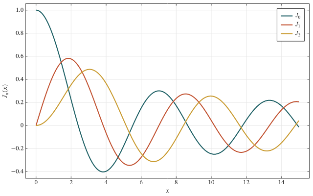
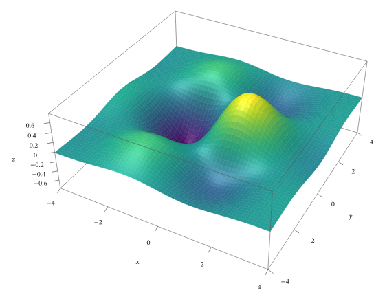
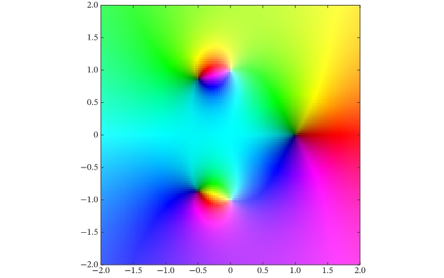
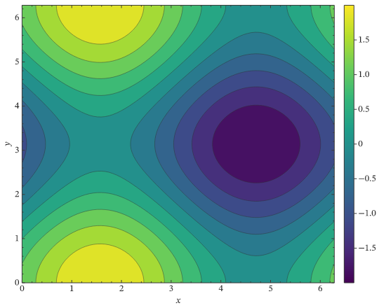

# MathCAS v2

MathCAS is a free computer algebra system: exact and symbolic mathematics, numbers to any precision, plots, and a
notebook to work in. It runs on Windows, Linux and macOS, and everything in it is one program you can read and build.


*A session in the notebook ([MP4 version](docs/media/workflow.mp4)). Every frame is the real program, recorded by
[tools/demo/workflow.py](tools/demo/workflow.py).*

## A first look

Each line is an input; the comment is what MathCAS answers.

```text
2^100 + 1/3                               # 3802951800684688204490109616129/3
factor(x^4 - 1)                           # (-1 + x)*(1 + x)*(1 + x^2)
integrate(x^2 sin(x), x)                  # 2*cos(x) - cos(x)*x^2 + 2*x*sin(x)
integrate(exp(-x^2), [x, -inf, inf])      # pi^(1/2)
integrate(x^n, [x, 0, 1])                 # conditional_expression((1 + n)^-1, re(n) > -1)
series(exp(x), x, 0, 4)                   # 1 + x + x^2/2 + x^3/6 + x^4/24 + O(x^5)
sum(binomial(n, k)^2, [k, 0, n])          # binomial(2*n, n)
solve(x^3 - 6 x^2 + 11 x - 6 == 0, x)     # [[x -> 1], [x -> 2], [x -> 3]]
d_solve(y''(x) + 4 y(x) == sin(x), y(x), x)   # [[y(x) -> (1/3)*sin(x) + c(1)*cos(2*x) + c(2)*sin(2*x)]]
resolve(for_all(x, x^2 + b x + 1 > 0))    # b < 2 and b > -2
full_simplify(sin(pi/5))                  # (5/8 - (1/8)*5^(1/2))^(1/2)
eigenvalues([[2, 1], [1, 3]])             # [5/2 + (1/2)*5^(1/2), 5/2 - (1/2)*5^(1/2)]
n(pi, 50)                                 # 3.14159265358979323846264338327950288419716939937510...
find_root(cos(x) == x, [x, 1])            # [x -> 0.7390851332151607]
n_integrate(sin(x)/x, [x, 0, inf], working_precision: 30)   # 1.57079632679489661923132169163975
quantity(3, "Meters") + quantity(2, "Feet")   # quantity(1504/127, "Feet")
```

Three things to know before you type:

- **A space multiplies.** `2 pi r` and `m c^2` are products. `f(x)` is a call and `f (x)` is the product of `f`
  and `x`; the notebook shows a faint `×` wherever a space multiplies, so you can see which one you wrote.
- **Exact stays exact.** `1/3` is a rational and `sqrt(2)` a root until you ask for digits with `n(...)`. Numbers
  with a decimal point are machine numbers; `n(x, 50)` gives 50 digits, and only correct digits are shown.
- **Failures are values.** `1/0` gives `failure(division_by_zero)`, and a function that cannot do something returns
  its input unevaluated or a failure that says why. It does not guess.

## Install

Download the latest release from the repository's **Releases** page.

| System | File | How |
|---|---|---|
| Windows (x64) | `MathCAS-v2-<version>-win-x64.exe` | run the installer; it adds the notebook, the documentation window and the `.mcn` file association |
| Windows (x64) | `MathCAS-v2-<version>-win-x64.zip` | unpack anywhere and run `mc-notebook.exe` |
| Linux (x64) | `MathCAS-v2-<version>-linux-x64.AppImage` | `chmod +x` it and run it; `<AppImage> repl` starts the REPL |
| Linux (x64) | `MathCAS-v2-<version>-linux-x64.tar.gz` | unpack and run `./install.sh` (per user, no root needed) |
| macOS (Apple Silicon) | `MathCAS-v2-<version>-macos-arm64.dmg` | open the image and drag the application to Applications; the first launch needs Open from the context menu (the application is not notarized) |
| macOS (Intel) | `MathCAS-v2-<version>-macos-x64.dmg` | the same, for a Mac with an Intel processor (macOS 11 or later) |

The `nightly` pre-release is rebuilt from every push to `main`.

## The notebook

Start **MathCAS Notebook**, type an input and press **Shift+Enter**. A notebook is one `.mcn` file: plain text with
its pictures embedded, so it is easy to keep, share and put under version control.

| Key | What it does |
|---|---|
| Shift+Enter | evaluate the cell |
| Ctrl+/, Ctrl+6, Ctrl+2, Ctrl+5 | fraction, power, square root, n-th root: written mathematics in the input, edited in place |
| Ctrl+Space | leave the fraction, power or root |
| Esc `a` Esc | a Greek letter or symbol by its alias (Insert menu lists them); Esc `*` Esc types `×` |
| Ctrl+Shift+V | paste text as written mathematics |
| F1 | the documentation page of the function at the cursor |
| Ctrl+click | open a function's page; hovering a name shows its usage |
| Ctrl+wheel, Ctrl+0 | magnify, reset |

- **Completion:** typing a name lists the functions that match, each with a one-line description; a hint shows the
  argument you are in.
- **Warnings while typing:** `sin x` is the product `sin*x`, and `x(x - a)` calls `x`. The editor underlines both
  and offers the fix.
- **Plots:** hover for coordinate read-outs that snap to the curves. Drag a 3D picture to turn it.
- **Sliders:** `manipulate(plot(sin(a x), [x, 0, 2 pi]), [a, 1, 5])` gives a slider for `a`.
- **Export:** File > Export writes HTML or PDF.
- **Themes:** light and a near-black dark; plots follow the theme.

The **documentation window** (F1, or `mc-docs`) has a page for each of about 1,900 functions. Every example on a
page is checked against the engine on each build, and every name links to its page.

## The language

```text
fn f(x) = x^2 + 1                     # a function
fn fact(0) = 1                        # clauses, tried in order
fn fact(n: Int) when n > 0 = n fact(n - 1)
fn g(x: numeric) = n_integrate(exp(-t^2), [t, 0, x])   # only for numbers: g(a) stays g(a)
h = x => sin(x)/x                     # a lambda
xs = table(k^2, k, 10)                # [1, 4, ..., 100]
total(select(xs, is_even))            # 220
range(5) |> map(k => k^2, _)          # [1, 4, 9, 16, 25]
x^2 + y /. [x -> 3]                   # 9 + y        (rules and replacement)
assuming(a > 0, integrate(exp(-a x), [x, 0, inf]))   # a^-1
plot([sin(x), cos(x)], [x, 0, 2 pi], legend: ["sin", "cos"])
```

Names are lexical, options are written `name: value`, and lists are `[...]`. Scripts are `.mc` files:

```bash
mc-repl                          # the REPL
mc-repl script.mc                # run a script
mc-repl -e "factor(x^6 - 1)"     # evaluate one expression
mc-repl notebook.mcn --update    # evaluate a notebook and write its outputs back
```

[examples/](examples) has scripts, a module, a notebook and Jupyter notebooks.

**Other front ends**
- **Jupyter:** `python editors/jupyter/install.py` registers the kernel; plots show inline.
- **VS Code:** [editors/vscode](editors/vscode) gives diagnostics while typing, completion, signature help, hover
  with links to the documentation, and Run File.
- **Any editor:** `mc-lsp` is a language server over standard input and output.

## What it covers

| Area | What is there |
|---|---|
| Exact arithmetic | integers and rationals of any size, algebraic numbers, exact constants, number fields, finite fields |
| Algebra | expand, multivariate factoring (also over extensions), gcd, resultants, Groebner bases, `simplify` and `full_simplify` with assumptions |
| Calculus | derivatives; integrals by a Risch-style engine and a rule table; definite integrals with conditions on parameters; limits by Gruntz's algorithm; series and asymptotic expansions; sums and products in closed form |
| Equations | `solve` and `reduce` for polynomial systems and transcendental equations; quantifier elimination over the reals; `d_solve` for ordinary, partial and delay equations; recurrences |
| Transforms | Laplace, Fourier, Mellin and z-transforms and their inverses |
| Optimisation | exact `minimize` and `maximize`; linear, quadratic, conic and semidefinite problems; integer variables |
| Numerics | arbitrary precision with error tracking; roots, minima, integrals (oscillatory and singular ones too), stiff ODEs, boundary-value problems; machine code for machine numbers; parallel `table` and `map` |
| Special functions | about 400, real and complex, at any precision: Bessel, hypergeometric, elliptic, Mathieu, Heun, Weierstrass and many more |
| Linear algebra | exact and numeric decompositions, eigensystems at any precision, matrix functions |
| Values with meaning | quantities with units, intervals and centered intervals, uncertain values, datasets, geometric regions |
| Plots | more than 100 plot and chart types in 2D and 3D, LaTeX labels, export to PNG, SVG, PDF and animated GIF |
| Data | CSV, TSV, JSON, PNG, PDF and binary import and export; string patterns; time series |

| | |
|---|---|
|  |  |
| `plot` with LaTeX labels and a legend | `plot3d`, by MathCAS's own 3D renderer |
|  |  |
| `complex_plot`: zeros and poles by domain colouring | `contour_plot` with a colour bar |

*Made by [tools/demo/gallery.mc](tools/demo/gallery.mc).*

## How it is checked

- **Answers check themselves.** Every antiderivative is differentiated back, every solution of an equation is
  substituted in, every new rewrite of the simplifier and every transform value is compared numerically. A result
  that fails its check is not returned.
- **The test suite** has about 3,150 tests, and the 1,900 documentation pages are re-run on each build: a stored
  output that no longer matches fails the build.
- **A large example corpus** (about 44,000 inputs with known answers) is run before each release. In 0.15.0, 80.5%
  give the known answer outright; the rest are mostly inputs MathCAS leaves unevaluated, or answers in another equal
  form, and the check finds none of them to be a wrong value. That is a statement about this corpus, not a proof: if
  you find a wrong answer, please open an issue with the input.

The [changelog](CHANGELOG.md) lists what each release fixed.

## Building from source

MathCAS is a Rust workspace: 65 crates, about 400,000 lines. A recent stable Rust toolchain is all you need. The
notebook uses the system's graphics drivers (Direct3D 12 or OpenGL on Windows; Vulkan or OpenGL with Wayland or X11
on Linux; Metal on macOS). The compiler version is pinned in `rust-toolchain.toml`.

```bash
cargo build --release                             # everything
cargo run --release -p mc-notebook                # the notebook
cargo run --release -p mc-repl -- -e "1 + 1"      # the REPL
cargo test --release --workspace                  # the test suite
cargo run --release -p mc-docs --bin mc-docs-pages -- check   # the documentation's examples
```

`tools/test.ps1` runs the suite on every core with progress and a time and memory limit per test binary. CI builds
and tests Windows, Linux and macOS on every push ([ci.yml](.github/workflows/ci.yml)).

**Packages**
- **Windows:** `tools/dist.ps1` builds a release folder; `tools/package.ps1` builds the installer (needs Inno
  Setup 6) and the zip.
- **Linux:** `packaging/linux/build-tarball.sh` builds the tarball and `packaging/linux/build-appimage.sh` the
  AppImage (needs `appimagetool`).
- **macOS:** `packaging/macos/build-app.sh` builds the application bundle and the disk image, and
  `packaging/macos/smoke.sh` tests an image.
- **Android:** `packaging/android/build-apk.sh` builds the notebook's package for phones, tablets and emulators
  (needs the Android SDK and NDK), and `packaging/android/smoke.sh` tests it on an emulator or a device.
- **On GitHub:** a push to `main` publishes the `nightly` pre-release; a tag `v<version>` publishes a numbered
  release with that version's changelog. Both hold the four packages ([packages.yml](.github/workflows/packages.yml)).

## How it is built

The crates are arranged by responsibility, and a tool (`tools/depcheck.ps1`) checks the rules on every change: for
example, the notebook, editor and export crates do not depend on the evaluator.

| Part | Crates |
|---|---|
| Foundation | `mc-api` (the engine interface), `mc-core` (terms and the heap), `mc-arith` (exact, ball and machine numbers), `mc-syntax`, `mc-eval` (evaluator, patterns, rules), `mc-load` |
| Mathematics | `mc-poly`, `mc-algebra`, `mc-simplify`, `mc-calculus`, `mc-limit`, `mc-integrals`, `mc-transforms`, `mc-dsolve`, `mc-solve`, `mc-linalg`, `mc-special`, `mc-numtheory` and others |
| Numerics | `mc-numeric`, `mc-jit`, `mc-roots`, `mc-quad`, `mc-ode`, `mc-dist`, `mc-random` |
| Graphics | `mc-graphics` (model and 2D/3D renderers), `mc-plot` |
| Assembly | `mc-libraries` (the registry of libraries), `mc-engine`, `mc-kernel` |
| Front ends | `mc-notebook` with `mc-edit` (the input editor), `mc-boxes`, `mc-nbmodel`, `mc-nbfile`, `mc-nbexport`; `mc-docs`; `mc-repl`; `mc-lsp` |

Part of the library is written in MathCAS itself, in [lib/](lib). The design documents in
[docs/design](docs/design) describe semantics, syntax, numbers, the evaluator, the notebook, the editor and the
architecture ([12-architecture.md](docs/design/12-architecture.md) has the measured dependency graph). Each
crate has a `README.md` with its modules, its design decisions and how it is tested.

### Crates

**Foundation**
- [mc-api](crates/mc-api/README.md): the interface contract, the `Store` and `Engine` traits
- [mc-core](crates/mc-core/README.md): the term store, a concurrent hash-consed arena with a generational collector
- [mc-arith](crates/mc-arith/README.md): the number tower, canonical arithmetic and the canonical order of terms
- [mc-syntax](crates/mc-syntax/README.md): lexer, parser, lowering to terms and the printer
- [mc-eval](crates/mc-eval/README.md): patterns, the matcher, rule indexes and the parallel evaluator
- [mc-load](crates/mc-load/README.md): files, modules, imports, name resolution and the prelude
- [mc-langlib](crates/mc-langlib/README.md): core-language functions written in MathCAS

**Mathematics**
- [mc-poly](crates/mc-poly/README.md): polynomials: GCD, factorisation, resultants, Groebner bases, root isolation
- [mc-algebra](crates/mc-algebra/README.md): algebraic numbers and number fields
- [mc-fields](crates/mc-fields/README.md): finite fields with Conway polynomials
- [mc-groups](crates/mc-groups/README.md): permutation and finitely presented groups, posets, matroids
- [mc-simplify](crates/mc-simplify/README.md): simplification, assumptions and rewriting
- [mc-decide](crates/mc-decide/README.md): the decision service for signs, zeros and membership under assumptions
- [mc-cad](crates/mc-cad/README.md): cylindrical algebraic decomposition and quantifier elimination
- [mc-calculus](crates/mc-calculus/README.md): differentiation, partial fractions and properties of functions
- [mc-limit](crates/mc-limit/README.md): limits by Gruntz's algorithm
- [mc-integrals](crates/mc-integrals/README.md): the dispatcher of `integrate` and its base methods
- [mc-integrate](crates/mc-integrate/README.md): integration over a differential tower (Risch, Risch-Norman)
- [mc-integrate-rules](crates/mc-integrate-rules/README.md): rule-based indefinite integration
- [mc-transforms](crates/mc-transforms/README.md): Laplace, Mellin, Fourier and Z transforms
- [mc-dsolve](crates/mc-dsolve/README.md): symbolic differential equations and recurrences
- [mc-diffalg](crates/mc-diffalg/README.md): symmetries and differential algebra, written in MathCAS
- [mc-solve](crates/mc-solve/README.md): equations, `reduce` and root objects
- [mc-sums](crates/mc-sums/README.md): sums, products and their convergence
- [mc-linalg](crates/mc-linalg/README.md): linear algebra
- [mc-lists](crates/mc-lists/README.md): lists and compound expressions
- [mc-assoc](crates/mc-assoc/README.md): sets, associations and datasets
- [mc-strings](crates/mc-strings/README.md): strings
- [mc-special](crates/mc-special/README.md): special functions
- [mc-numtheory](crates/mc-numtheory/README.md): number theory
- [mc-combinat](crates/mc-combinat/README.md): number sequences and representations
- [mc-geom](crates/mc-geom/README.md): regions and computational geometry
- [mc-mechanics](crates/mc-mechanics/README.md): analytical mechanics, written in MathCAS
- [mc-further-functions](crates/mc-further-functions/README.md): functions written against the other libraries
- [mc-wavelets](crates/mc-wavelets/README.md): wavelet transforms, written in MathCAS

**Numerics**
- [mc-numeric](crates/mc-numeric/README.md): constants, elementary functions on exact, ball and machine numbers, `n`
- [mc-numfn](crates/mc-numfn/README.md): the `NumFn` trait through which numeric solvers see a function
- [mc-jit](crates/mc-jit/README.md): the numeric compiler
- [mc-roots](crates/mc-roots/README.md): root finding, minimisation and optimisation
- [mc-quad](crates/mc-quad/README.md): numerical integration
- [mc-ode](crates/mc-ode/README.md): numerical differential equations
- [mc-dist](crates/mc-dist/README.md): probability distributions and statistics
- [mc-random](crates/mc-random/README.md): random numbers

**Graphics**
- [mc-graphics](crates/mc-graphics/README.md): the graphics model and the 2D and 3D renderers
- [mc-graphics-kernel](crates/mc-graphics-kernel/README.md): the natives that build and check graphics terms
- [mc-plot](crates/mc-plot/README.md): plots and charts
- [mc-typeset](crates/mc-typeset/README.md): typesetting of outputs
- [mc-mathfont](crates/mc-mathfont/README.md): the math font and its MATH table

**Assembly**
- [mc-libraries](crates/mc-libraries/README.md): the registry of libraries
- [mc-engine](crates/mc-engine/README.md): the assembled core behind the `Engine` trait
- [mc-kernel](crates/mc-kernel/README.md): the kernel process and its protocol
- [mc-io](crates/mc-io/README.md): import and export of data files and images
- [mc-bench](crates/mc-bench/README.md): the benchmark runner

**Front ends**
- [mc-notebook](crates/mc-notebook/README.md): the notebook window
- [mc-notebook-android](crates/mc-notebook-android/README.md): the notebook as an Android app
- [mc-ui](crates/mc-ui/README.md): window support shared by the notebook and the documentation window
- [mc-edit](crates/mc-edit/README.md): the input editor of code cells
- [mc-boxes](crates/mc-boxes/README.md): box trees and their layout
- [mc-nbmodel](crates/mc-nbmodel/README.md): the document model of the notebook
- [mc-nbfile](crates/mc-nbfile/README.md): the `.mcn` notebook file format
- [mc-nbexport](crates/mc-nbexport/README.md): HTML and PDF export of notebooks
- [mc-docs](crates/mc-docs/README.md): function pages, their checker and the documentation window
- [mc-help](crates/mc-help/README.md): the help index
- [mc-repl](crates/mc-repl/README.md): the REPL and script runner
- [mc-lsp](crates/mc-lsp/README.md): the language server

## Author

MathCAS v2 is written by Rajat Mandal.

## License

Copyright (C) 2026 Rajat Mandal.

MathCAS v2 is free software: you can redistribute it and/or modify it under the terms of the GNU General Public
License as published by the Free Software Foundation, either version 3 of the License, or (at your option) any later
version (`GPL-3.0-or-later`; the text is in [LICENSE](LICENSE)). It is distributed in the hope that it will be useful,
but WITHOUT ANY WARRANTY; without even the implied warranty of MERCHANTABILITY or FITNESS FOR A PARTICULAR PURPOSE.

The libraries it is built with keep their own licences (MIT, Apache-2.0, BSD, Zlib, ISC and similar, all compatible
with GPL-3.0); the bundled fonts are under the SIL Open Font License 1.1 (STIX Two Math), the Bitstream Vera licence
(DejaVu) and Apache-2.0 (Noto Sans), with their licence files next to them.
