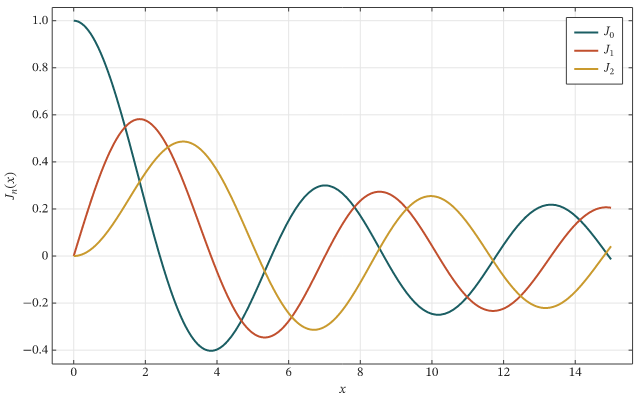
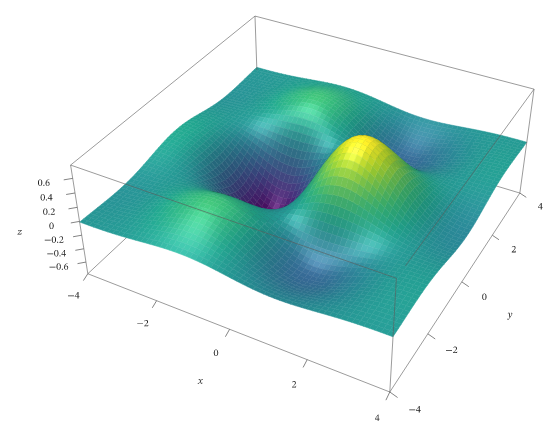
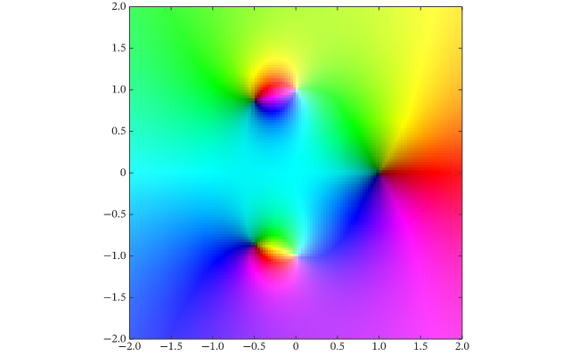
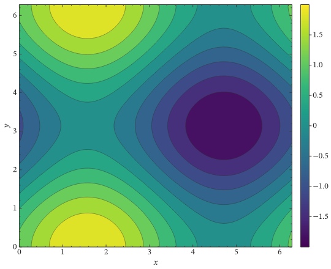
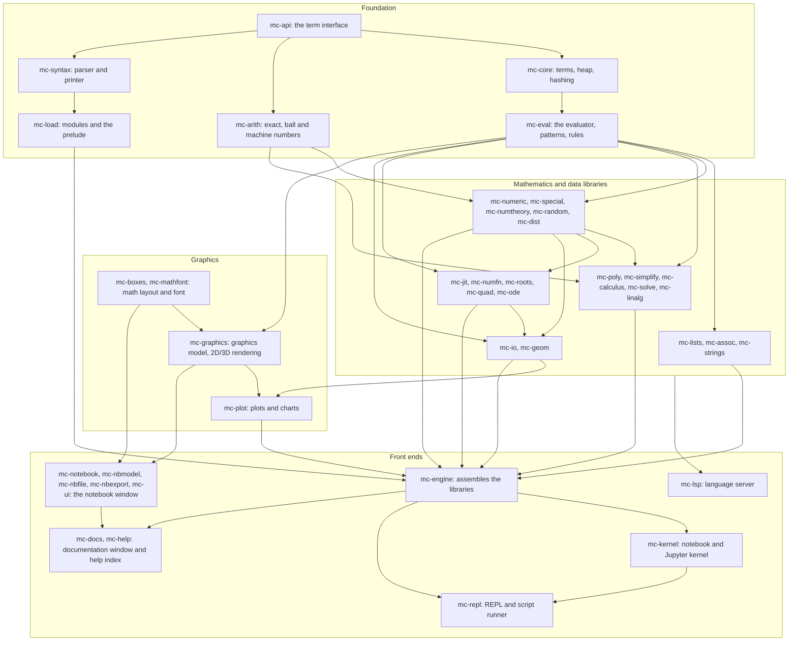

# MathCAS v2

A free computer algebra system for exact, symbolic and high-precision numeric mathematics, with a native notebook,
publication-quality plots and a small, readable language. It runs on Windows and Linux.


*A session in the MathCAS notebook ([MP4 version](docs/media/workflow.mp4)). Every frame is the real program.*

## What you can do with it

```text
2^100 + 1/3                               # 3802951800684688204490109616129/3
factor(x^4 - 1)                           # (-1 + x)*(1 + x)*(1 + x^2)
d(sin(x)^2, x)                            # 2*cos(x)*sin(x)
integrate(1/(x^2 - 1), x)                 # (-1/2)*log(1 + x) + (1/2)*log(-1 + x)
series(exp(x), x, 0, 4)                   # 1 + x + x^2/2 + x^3/6 + x^4/24 + O(x^5)
sum(1/k^2, [k, 1, inf])                   # (1/6)*pi^2
solve(x^2 - 5*x + 6 == 0, x)              # [[x -> 2], [x -> 3]]
n(sqrt(2), 50)                            # 1.4142135623730950488016887242096980785696718753769...
find_root(cos(x) == x, [x, 1])            # [x -> 0.7390851332151607]
n_integrate(exp(-x^2), [x, -inf, inf])    # 1.7724538509055163
region_measure(disk([0, 0], 2))           # 4*pi
quantity(3, "Meters") + quantity(2, "Feet")   # quantity(1504/127, "Feet")
range(5) |> map(k => k^2, _)              # [1, 4, 9, 16, 25]
```

- **Exact and symbolic:**
  - integers, rationals and exact constants of any size;
  - polynomials: expand, multivariate factor, gcd;
  - `simplify` and `refine` with assumptions;
  - derivatives, integrals, limits, series, sums and products;
  - `solve`, `reduce`, `d_solve`, `r_solve`;
  - `minimize`/`maximize` with constraints, Fourier transforms;
  - number theory.
- **Numeric:**
  - arbitrary precision that shows only correct digits;
  - machine numbers compiled to native code;
  - roots, minima, fits, integrals;
  - ODEs: stiff, with events, and boundary-value problems;
  - interpolation, linear algebra, probability distributions and statistics;
  - about 300 special functions, real and complex;
  - parallel `table` and `map`.
- **Values with meaning:** quantities with units, uncertain values (`around`), intervals, datasets, geometric regions.
- **Plots and graphics:**
  - about 100 plot types in 2D and 3D: log and signed-log axes, contour, density, vector, stream, region, complex,
    graph and chart plots;
  - LaTeX labels and legends;
  - export to PNG, SVG, PDF and animated GIF.
- **Data:** import and export of CSV, TSV, JSON, PNG, PDF and plain text tables.

| | |
|---|---|
|  |  |
| `plot` with LaTeX labels and a legend | `plot3d`, rendered by MathCAS's own 3D renderer |
|  |  |
| `complex_plot`: zeros and poles by domain colouring | `contour_plot` with a colour bar |

*Made by [tools/demo/gallery.mc](tools/demo/gallery.mc).*

## Install

Download the latest release from the repository's **Releases** page:

| System | File | How |
|---|---|---|
| Windows (x64) | `MathCAS-v2-<version>-win-x64.exe` | run the installer; it adds the notebook, the documentation window and `.mcn` file association |
| Windows (x64) | `MathCAS-v2-<version>-win-x64.zip` | unpack anywhere and run `mc-notebook.exe` |
| Linux (x64) | `MathCAS-v2-<version>-linux-x64.AppImage` | `chmod +x` it and run it; `<AppImage> repl` starts the REPL |
| Linux (x64) | `MathCAS-v2-<version>-linux-x64.tar.gz` | unpack and run `./install.sh` (per user, no root needed) |

The `nightly` pre-release is rebuilt from every push to `main`.

## Using the notebook

Start **MathCAS Notebook**. Type an input and press **Shift+Enter** to evaluate it. A notebook is one `.mcn` file
(plain text, with its pictures embedded), so it is easy to keep, share and put under version control.

| Key | What it does |
|---|---|
| Shift+Enter | evaluate the cell (Evaluation menu: evaluate all, abort) |
| Ctrl+2, Ctrl+/, Ctrl+6 | square root, fraction, power: written mathematics in the input, edited in place |
| F1 | the documentation page of the function at the cursor |
| typing a name | completion with a one-line description of each function (Tab or Enter accepts); a hint shows the current argument |
| Ctrl+click | open a function's page; hovering a name shows its usage |
| Ctrl+wheel, Ctrl+0 | magnify, reset |
| Ctrl+Shift+J | outputs left or right (View menu) |

- **Plots:** hover a plot for coordinate read-outs that snap to the curves.
- **3D pictures:** drag to turn them; the wheel zooms while one is selected, and a double-click resets the view.
- **Sliders:** `manipulate(plot(sin(a*x), [x, 0, 2pi]), [a, 1, 5])` shows a slider for `a`, and the plot follows it.
- **Export:** File > Export writes the notebook as HTML or PDF.
- **Themes:** light and dark.

The **documentation window** (`mc-docs`, also opened by F1) has a page for every function, with examples that are
checked against the engine, and every name links to its page. The guide
[docs/guide/quickstart.tex](docs/guide/quickstart.tex) (PDF in the release) walks through numeric work.

## The language in brief

```text
fn f(x) = x^2 + 1                     # a function
fn fact(0) = 1                        # rule clauses, tried in order
fn fact(n: Int) when n > 0 = n*fact(n - 1)
g = x => sin(x)/x                     # a lambda
xs = table(k^2, k, 10)                # [1, 4, ..., 100]
total(select(xs, is_even))            # 220
x^2 + y /. [x -> 3]                   # 9 + y        (rules and replacement)
assuming(a > 0, integrate(exp(-a*x), [x, 0, inf]))   # a^-1
plot([sin(x), cos(x)], [x, 0, 2pi], legend: ["sin", "cos"])
```

Scripts are `.mc` files. Run one with `mc-repl script.mc`, start the REPL with `mc-repl`, or evaluate an expression
with `mc-repl -e "factor(x^6 - 1)"`. `mc-repl notebook.mcn --update` evaluates a notebook from the command line and
writes its outputs back. [examples/](examples) has scripts, a module, a notebook and Jupyter notebooks.

**Other front ends:**
- **Jupyter:** register the kernel with `python editors/jupyter/install.py`; plots show inline.
- **VS Code:** [editors/vscode](editors/vscode) adds diagnostics while typing, completion with usage lines, signature
  help, hover with links to the documentation, and Run File.
- **Other editors:** any editor can start `mc-lsp` as a language server over standard input and output.

## Building from source

MathCAS is a Rust workspace (about 260,000 lines in 41 crates). You need a recent stable Rust toolchain; nothing else
is required to build or test it. The notebook uses the system's graphics drivers (Direct3D 12 or OpenGL on Windows;
Vulkan or OpenGL with Wayland or X11 on Linux).

```bash
cargo build --release                             # everything
cargo run --release -p mc-notebook                # the notebook
cargo run --release -p mc-repl -- -e "1 + 1"      # the REPL
cargo test --release --workspace                  # the test suite
cargo run --release -p mc-docs --bin mc-docs-pages -- check   # the documentation's examples
```

`tools/test.ps1` runs the suite one test binary at a time, with progress and memory and time limits. CI builds and
tests Windows and Linux on every push ([ci.yml](.github/workflows/ci.yml)).

### Distribution packages

- **Windows:** `powershell -File tools/dist.ps1` builds a release folder (the programs, examples, guide and editor
  support). `tools/package.ps1` then builds the installer, which needs Inno Setup 6, and the zip.
- **Linux:** `packaging/linux/build-tarball.sh` builds the tarball. `packaging/linux/build-appimage.sh` turns it into
  an AppImage, which needs `appimagetool`, and `packaging/linux/smoke.sh` checks a package.
- **On GitHub:** every push to `main` publishes the Windows installer and zip and the Linux tarball as the `nightly`
  pre-release ([nightly.yml](.github/workflows/nightly.yml)). Pushing a tag `v<version>` matching the workspace
  version publishes a numbered release with that version's changelog ([release.yml](.github/workflows/release.yml)).

## Internals

The crates form layers. Each crate depends only on crates in the layers above it, and the engine assembles the
libraries for the front ends.



| Layer | Crates |
|---|---|
| 0 | `mc-api`, `mc-help`, `mc-mathfont`, `mc-nbfile`, `mc-bench` |
| 1 | `mc-core`, `mc-arith`, `mc-syntax`, `mc-ui` |
| 2 | `mc-eval`, `mc-boxes`, `mc-load` |
| 3 | `mc-lists`, `mc-assoc`, `mc-strings`, `mc-numeric`, `mc-random`, `mc-graphics`, `mc-nbmodel`, `mc-nbexport` |
| 4 | `mc-special`, `mc-numtheory`, `mc-simplify`, `mc-io`, `mc-notebook` |
| 5 | `mc-poly`, `mc-jit`, `mc-dist` |
| 6 | `mc-calculus`, `mc-solve`, `mc-linalg`, `mc-numfn` |
| 7 | `mc-roots`, `mc-quad`, `mc-ode`, `mc-geom` |
| 8 | `mc-plot` |
| 9 | `mc-engine`, `mc-lsp` |
| 10 | `mc-kernel` |
| 11 | `mc-repl`, `mc-docs` |

The design documents in [docs/design](docs/design) describe each part: semantics, syntax, numbers, the evaluator, the
notebook and the roadmap. Each crate's `NOTES.md` records its decisions.

## Author

MathCAS v2 is written by Rajat Mandal, with Claude (Anthropic) as co-author.

## License

Copyright (C) 2026 Rajat Mandal.

MathCAS v2 is free software: you can redistribute it and/or modify it under the terms of the GNU General Public
License as published by the Free Software Foundation, either version 3 of the License, or (at your option) any later
version (`GPL-3.0-or-later`; the text is in [LICENSE](LICENSE)). It is distributed in the hope that it will be useful,
but WITHOUT ANY WARRANTY; without even the implied warranty of MERCHANTABILITY or FITNESS FOR A PARTICULAR PURPOSE.

The libraries it is built with keep their own licences (MIT, Apache-2.0, BSD, Zlib, ISC and similar, all compatible
with GPL-3.0); the bundled fonts are under the SIL Open Font License 1.1 (STIX Two Math), the Bitstream Vera licence
(DejaVu) and Apache-2.0 (Noto Sans), with their licence files next to them.
